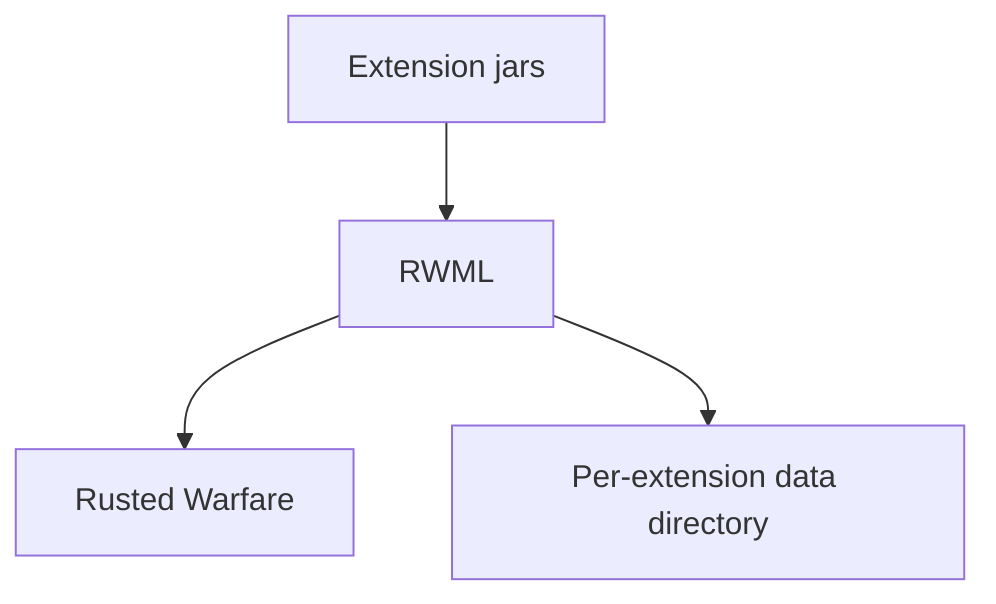

<h1 align="center">RWML</h1>

<p align="center">An extension framework for Rusted Warfare. Place extension jars alongside the game, and they are loaded, ordered and applied the next time it starts, including patches to the game's own classes.</p>

<div align="center">


</div>

<p align="center">
🇺🇸 <a href="./README.md">English</a> | 🇨🇳 <a href="./README.zh.md">简体中文</a>
</p>

## Table of Contents

- [Introduction](#introduction)
- [Capabilities](#capabilities)
- [Mechanism](#mechanism)
- [Installation](#installation)
- [Usage](#usage)
- [API Reference](#api-reference)
- [Building](#building)
- [Contributing](#contributing)
- [License](#license)

## Introduction

RWML makes Rusted Warfare extensible. It sits between the game and a set of extension jars: it discovers them, determines the order in which they load, and applies the changes they declare.

An **extension** is an ordinary jar file. It may add content, change how an existing class behaves, or react to the game's lifecycle. None of this requires editing the game's files by hand.

RWML is intended for extension authors and modpack maintainers, as well as for players who need to install and manage extensions.

## Capabilities

| Capability | Use |
|---|---|
| **Plug-in extensions** | Placing a jar in the `extensions/` directory is enough for it to be discovered. |
| **Class patching** | Declaring a mixin changes how any existing class behaves, game classes included, without replacing that class or deriving from it. |
| **Isolated loading** | Each extension has its own class loader, so two extensions may depend on different versions of the same library without conflicting. |
| **Dependency ordering** | An extension may declare the other extensions it depends on and their relative order, and RWML resolves the load order. When a dependency cannot be satisfied, the extension is skipped rather than causing the game to fail. |
| **Independent on/off** | A disabled extension is not loaded, and that setting persists into subsequent launches. |
| **Desktop and Android** | The same extension jar works on both. Because Android cannot modify classes at runtime, the changes are applied at build time. |
| **Automatic runtime** | RWML requires Java 25 and provisions it: on an older Java it fetches an official build once, caches it for reuse, and then restarts on it. |

## Mechanism


<!-- Experimental: if rendering fails, preview on GitHub -->

At launch, RWML collects the extension jars, orders them by the dependencies they declare, loads each one in its own class loader, and applies their class patches. The game then starts as usual, with the patches already in place.

## Installation

> [!IMPORTANT]
> RWML is installed **as a replacement** for the game's `game-lib.jar`. Back up the original file before overwriting it.

1. Obtain RWML's `game-lib.jar`.
2. Use it to replace the game's `game-lib.jar`.
3. Create an `extensions/` directory in the same folder.
4. Place extension jars in the `extensions/` directory.
5. Start the game.

```
<game dir>/
├── game-lib.jar          # replaced by RWML
└── extensions/           # your extension jars
```

| Platform | Requirement |
|---|---|
| Desktop | Java 8 or newer installed; RWML provisions Java 25 |
| Android | API 26 or newer |
| Building from source | JDK 17 or newer |

> [!NOTE]
> The first launch on an older Java requires network access to fetch the runtime. To skip that step, set `JAVA_HOME` to a JDK of the required version; RWML uses that JDK as it is.

To build RWML from source, see [Building](#building).

## Usage

### Installing an extension

Copy the jar into the `extensions/` directory, then restart the game. RWML reports what it loaded:

```text
[rwml] Loading 1 extension(s).
[rwml]   + Hello Extension 1.0.0  [com.example.hello]
[rwml] 1 loaded, 0 disabled, 0 skipped
```

### Disabling an extension

An extension can be disabled without deleting it. A disabled extension is skipped on the next launch, and its files remain where they are. Re-enabling it works the same way.

### Data directory

Each extension receives a private, writable directory, so two extensions never contend for the same file.

> [!WARNING]
> Extensions are loaded once per launch. There is no hot reload, so enabling or disabling one takes effect on the next start.

## API Reference

### The descriptor

The descriptor is the `META-INF/extension.properties` file inside the extension jar. Only `id` is required; every other key has a default, and `name` falls back to `id`.

```properties
id=com.example.hello
name=Hello Extension
version=1.0.0
mainClass=com.example.hello.HelloExtension
```

<details>
<summary><b>All descriptor keys</b></summary>

| Key | Meaning |
|---|---|
| `id` | Globally unique identifier, for example `com.example.hello` |
| `name` | Display name |
| `version` | Version of the extension itself |
| `mainClass` | Fully qualified entry point class |
| `author` / `authors` | Author, or a comma-separated list of authors |
| `description` | Long description for management tooling |
| `homepage` | Project home page |
| `icon` | Classpath resource path of an icon |
| `tags` | Comma-separated search tags |
| `license` / `licenseUrl` | SPDX identifier and URL of the license text |
| `apiVersion` | Version of the RWML API the extension was built against |
| `javaVersion` | Minimum Java version the extension requires |
| `loadTimeoutMillis` | Timeout for the load callback, in milliseconds |
| `dependsOn` | Extensions that must be present and loaded first |
| `loadAfter` / `loadBefore` | Preferred ordering relative to other extensions |

</details>

### The entry point

The entry point is a class that implements `Extension`, referenced by `mainClass`. When the extension is loaded, `onLoad` is called once.

```java
@ExtensionInfo(id = "com.example.hello", name = "Hello Extension")
public final class HelloExtension implements Extension {

    @Override
    public void onLoad(ExtensionContext context) throws Exception {
        context.log("starting up");
        Path file = context.dataDirectory().resolve("last-load.txt");
        Files.write(file, Instant.now().toString().getBytes(StandardCharsets.UTF_8));
    }
}
```

The descriptor and the `@ExtensionInfo` annotation carry the same metadata. When both are present, the descriptor takes precedence. Either one alone is sufficient, so a minimal extension can be a single annotated class.

### `ExtensionContext`

| Method | Returns |
|---|---|
| `extensionId()` | The id declared by this extension |
| `dataDirectory()` | A private, writable directory for this extension |
| `classLoader()` | The isolated class loader that owns this extension |
| `mixin()` | The mixin bridge, for registering patches programmatically |
| `log(String)` | Write an informational message to the host log |
| `log(String, Throwable)` | Write an error message with a stack trace |

### Declaring order

```properties
dependsOn=com.example.core          # required; skipped when unavailable
loadAfter=com.example.core          # order hint
loadBefore=com.example.overrides    # order hint
```

`dependsOn` is a hard requirement: the named extension must exist and must load first. `loadAfter` and `loadBefore` are only ordering hints, and they are ignored when the named extension is absent.

### Patching a class

Declare the target class to patch and the injection point. The example below inserts a trace line at the start of a method:

```java
@AsmMixin("com/corrodinggames/rts/java/GameRuntime")
public final class GameRuntimeMixin {

    @AsmInject(method = "tick()I", target = InjectionPoint.HEAD)
    public static void onTick(CallbackInfo callbackInfo) {
        System.out.println("tick() called");
    }
}
```

**The target class need not exist at build time, and it need not be one of your own classes.** Mixins are discovered automatically from the extension jar.

`@AsmInject` takes a method descriptor and an injection point, and optionally accepts finer placement parameters: `ordinal`, `slice`, `cancellable`, `allow`, `expect`, `require` and `inline`.

> [!WARNING]
> An extension should depend on RWML with `compileOnly`. Do not bundle RWML or the bytecode framework into an extension jar; the host provides both.

## Building

### Prerequisites

| Item | Requirement |
|---|---|
| JDK | 17 or newer |
| The game's library | Needed by `packageGameJar` only. It is taken from `work/game-lib.jar`, or from `-PrwmlGameJar=<path>` when a different jar is wanted. |
| Android SDK | Needed by the `:android` module only. Set `ANDROID_HOME`, or set `android.sdk` in `gradle.properties`. |

### Commands

```bash
./gradlew build                    # compile every module and run the unit tests
./gradlew test                     # run the unit tests only
./gradlew packageGameJar           # produce the deployable build/dist/game-lib.jar
./gradlew :example:runDemo         # run the sample extension on the desktop
./gradlew :android:assembleDebug   # build the Android APK
```

### Outputs

| Path | Contents |
|---|---|
| `build/dist/game-lib.jar` | The drop-in replacement, ready to deploy. |
| `build/libs/rwml-1.0.0.jar` | The RWML library, which an extension is compiled against. |
| `example/build/libs/rwml-example-hello-1.0.0.jar` | The sample extension jar. |
| `android/build/outputs/apk/debug/android-debug.apk` | The Android application. |

## Contributing

Issues and pull requests are welcome.

```bash
./gradlew test          # the test suite; keep it passing
./gradlew :example:runDemo
```

Before starting on anything large, please open an issue so that the approach can be agreed.

### Status

- [x] Drop-in deployment as a replacement `game-lib.jar`
- [x] Extension discovery, isolated loading and dependency ordering
- [x] Mixin-based patching of game classes, on desktop
- [x] Offline patching and dex packaging for Android
- [x] Automatic runtime provisioning
- [ ] Hot reload (extensions load once per launch)

## License

[Apache License 2.0](./LICENSE).
