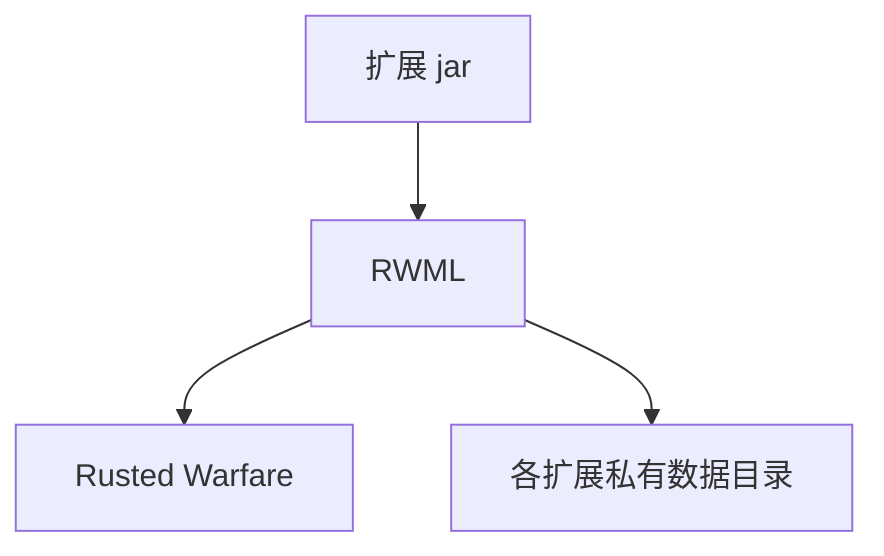

<h1 align="center">RWML</h1>

<p align="center">Rusted Warfare 的扩展框架。将扩展 jar 放在游戏目录下，游戏下次启动时便会自动加载、排序并生效，其中也包括对游戏自身类的修补。</p>

<div align="center">


</div>

<p align="center">
🇺🇸 <a href="./README.md">English</a> | 🇨🇳 <a href="./README.zh.md">简体中文</a>
</p>

## 目录

- [简介](#简介)
- [作用](#作用)
- [机制](#机制)
- [安装](#安装)
- [使用](#使用)
- [API 参考](#api-参考)
- [构建](#构建)
- [贡献](#贡献)
- [许可](#许可)

## 简介

RWML 为 Rusted Warfare 提供扩展能力。它位于游戏与一组扩展 jar 之间，负责发现这些扩展、确定它们的加载顺序，并施加它们所声明的改动。

**扩展**即普通的 jar 文件。它可以添加内容、改变既有类的行为，或响应游戏的生命周期。以上过程均不需要手工修改游戏文件。

RWML 主要面向扩展作者与整合包维护者，以及需要安装和管理扩展的玩家。

## 作用

| 能力 | 用处 |
|---|---|
| **插件式扩展** | 将 jar 放入 `extensions/` 目录即可被识别。 |
| **类修补** | 通过声明 mixin 即可改变任意既有类的行为，游戏自身的类同样适用，且不必替换该类或为其派生子类。 |
| **隔离加载** | 每个扩展拥有独立的类加载器，因此两个扩展即使依赖同一库的不同版本，也不会相互冲突。 |
| **依赖排序** | 扩展可以声明它所依赖的其他扩展以及先后关系，加载顺序由 RWML 自动解析。若依赖无法满足，该扩展会被跳过，而不会导致游戏崩溃。 |
| **独立启停** | 被禁用的扩展不会被加载，该设置会保留至后续启动。 |
| **桌面与 Android** | 同一个扩展 jar 在两端均可使用。由于 Android 无法在运行期修改类，相关改动在构建时施加。 |
| **自动准备运行时** | RWML 需要 Java 25，并会自行准备：在较旧的 Java 上运行时会获取一次官方构建，将其缓存以供复用，然后在其上重新启动。 |

## 机制


<!-- Experimental: if rendering fails, preview on GitHub -->

启动时，RWML 会收集所有扩展 jar，按照它们声明的依赖关系进行排序，在各自的类加载器中逐个加载，并施加它们的类修补。随后游戏照常启动，此时补丁已经就位。

## 安装

> [!IMPORTANT]
> RWML 以**替换**游戏 `game-lib.jar` 的方式安装。覆盖原文件之前，请先做好备份。

1. 取得 RWML 的 `game-lib.jar`。
2. 用它替换游戏原有的 `game-lib.jar`。
3. 在同一目录下创建 `extensions/` 目录。
4. 将扩展 jar 放入 `extensions/` 目录。
5. 启动游戏。

```
<游戏目录>/
├── game-lib.jar          # 由 RWML 替换
└── extensions/           # 扩展 jar 存放处
```

| 平台 | 要求 |
|---|---|
| 桌面 | 已安装 Java 8 或更高版本；Java 25 由 RWML 自行准备 |
| Android | API 26 或更高 |
| 从源码构建 | JDK 17 或更高 |

> [!NOTE]
> 在较旧的 Java 上首次启动时，需要联网获取运行时。如需跳过此步骤，可将 `JAVA_HOME` 指向所需版本的 JDK，RWML 会直接使用该 JDK。

从源码构建 RWML 的说明见[构建](#构建)。

## 使用

### 安装扩展

将 jar 复制到 `extensions/` 目录，然后重启游戏。RWML 会报告加载结果：

```text
[rwml] Loading 1 extension(s).
[rwml]   + Hello Extension 1.0.0  [com.example.hello]
[rwml] 1 loaded, 0 disabled, 0 skipped
```

### 禁用扩展

扩展可以禁用，而不必删除文件。被禁用的扩展在下次启动时会被跳过，其文件仍保留在原处。重新启用时采用同样的方式。

### 数据目录

每个扩展都会获得一个专属的可写目录，因此两个扩展不会争用同一个文件。

> [!WARNING]
> 扩展在每次启动时只加载一次，不支持热重载，因此启用或禁用的操作要在下次启动时才会生效。

## API 参考

### 描述符

描述符位于扩展 jar 内的 `META-INF/extension.properties`。其中仅 `id` 为必填项，其余各键均有默认值；`name` 省略时取 `id` 的值。

```properties
id=com.example.hello
name=Hello Extension
version=1.0.0
mainClass=com.example.hello.HelloExtension
```

<details>
<summary><b>全部描述符键</b></summary>

| 键 | 含义 |
|---|---|
| `id` | 全局唯一标识，例如 `com.example.hello` |
| `name` | 显示名称 |
| `version` | 扩展自身的版本 |
| `mainClass` | 入口类的全限定名 |
| `author` / `authors` | 作者，或逗号分隔的作者列表 |
| `description` | 供管理工具展示的长描述 |
| `homepage` | 项目主页 |
| `icon` | 图标的类路径资源位置 |
| `tags` | 逗号分隔的检索标签 |
| `license` / `licenseUrl` | SPDX 标识与许可全文地址 |
| `apiVersion` | 扩展编译时所依赖的 RWML API 版本 |
| `javaVersion` | 扩展要求的最低 Java 版本 |
| `loadTimeoutMillis` | 加载回调的超时时间，单位为毫秒 |
| `dependsOn` | 必须存在且先于本扩展加载的扩展 |
| `loadAfter` / `loadBefore` | 相对于其他扩展的加载顺序偏好 |

</details>

### 入口类

入口类是实现 `Extension` 接口的类，由 `mainClass` 指向。扩展加载时，`onLoad` 会被调用一次。

```java
@ExtensionInfo(id = "com.example.hello", name = "Hello Extension")
public final class HelloExtension implements Extension {

    @Override
    public void onLoad(ExtensionContext context) throws Exception {
        context.log("starting up");
        Path file = context.dataDirectory().resolve("last-load.txt");
        Files.write(file, Instant.now().toString().getBytes(StandardCharsets.UTF_8));
    }
}
```

描述符与 `@ExtensionInfo` 注解承载同一组元数据。两者同时存在时，以描述符为准；只需提供其中之一，因此最小的扩展可以只是一个带注解的类。

### `ExtensionContext`

| 方法 | 返回 |
|---|---|
| `extensionId()` | 本扩展声明的 id |
| `dataDirectory()` | 本扩展专属的可写目录 |
| `classLoader()` | 拥有本扩展的隔离类加载器 |
| `mixin()` | mixin 桥，用于以代码方式注册补丁 |
| `log(String)` | 向宿主日志写入一条消息 |
| `log(String, Throwable)` | 写入一条带堆栈信息的错误消息 |

### 声明顺序

```properties
dependsOn=com.example.core          # 硬性要求；无法满足时跳过
loadAfter=com.example.core          # 顺序提示
loadBefore=com.example.overrides    # 顺序提示
```

`dependsOn` 是硬性要求，所指扩展必须存在并先于本扩展加载。`loadAfter` 与 `loadBefore` 仅为顺序提示，当所指扩展不存在时会被忽略。

### 修补类

声明需要修补的目标类以及注入点。下例在方法开头插入一行输出：

```java
@AsmMixin("com/corrodinggames/rts/java/GameRuntime")
public final class GameRuntimeMixin {

    @AsmInject(method = "tick()I", target = InjectionPoint.HEAD)
    public static void onTick(CallbackInfo callbackInfo) {
        System.out.println("tick() called");
    }
}
```

**目标类不必在构建期存在，也不必属于扩展自身。** mixin 会从扩展 jar 中被自动识别。

`@AsmInject` 接收方法描述符与注入点，并可选用更精细的定位参数：`ordinal`、`slice`、`cancellable`、`allow`、`expect`、`require`、`inline`。

> [!WARNING]
> 扩展应以 `compileOnly` 方式依赖 RWML。请勿将 RWML 或字节码框架打包进扩展 jar，这两者已由宿主提供。

## 构建

### 前置条件

| 项目 | 要求 |
|---|---|
| JDK | 17 或更高版本 |
| 游戏库文件 | 仅 `packageGameJar` 需要。取自 `work/game-lib.jar`，或用 `-PrwmlGameJar=<path>` 指定其他文件。 |
| Android SDK | 仅 `:android` 模块需要。设置 `ANDROID_HOME`，或在 `gradle.properties` 中设置 `android.sdk`。 |

### 命令

```bash
./gradlew build                    # 编译全部模块并运行单元测试
./gradlew test                     # 仅运行单元测试
./gradlew packageGameJar           # 生成可部署的 build/dist/game-lib.jar
./gradlew :example:runDemo         # 在桌面端运行示例扩展
./gradlew :android:assembleDebug   # 构建 Android APK
```

### 产物

| 路径 | 内容 |
|---|---|
| `build/dist/game-lib.jar` | 可直接部署的替换文件。 |
| `build/libs/rwml-1.0.0.jar` | RWML 库文件，编译扩展时以它为依赖。 |
| `example/build/libs/rwml-example-hello-1.0.0.jar` | 示例扩展 jar。 |
| `android/build/outputs/apk/debug/android-debug.apk` | Android 应用。 |

## 贡献

欢迎提交 issue 与 pull request。

```bash
./gradlew test          # 测试套件，请保持通过
./gradlew :example:runDemo
```

进行较大改动之前，请先提交 issue 以对齐方案。

### 状态

- [x] 以替换 `game-lib.jar` 的方式直接部署
- [x] 扩展发现、隔离加载与依赖排序
- [x] 桌面端基于 mixin 的游戏类修补
- [x] Android 端的离线修补与 dex 打包
- [x] 运行时自动准备
- [ ] 热重载（扩展在每次启动时只加载一次）

## 许可

[Apache License 2.0](./LICENSE).
